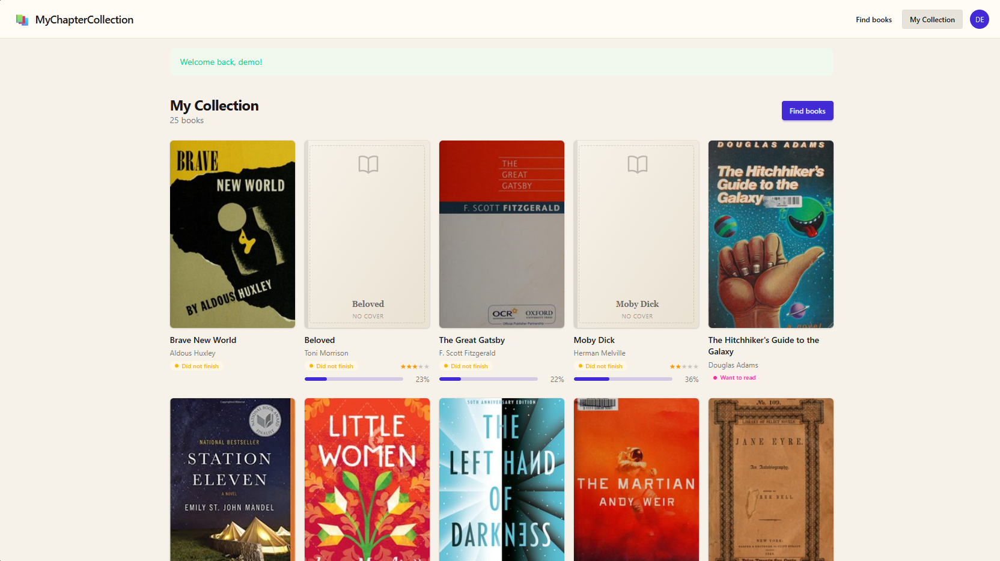
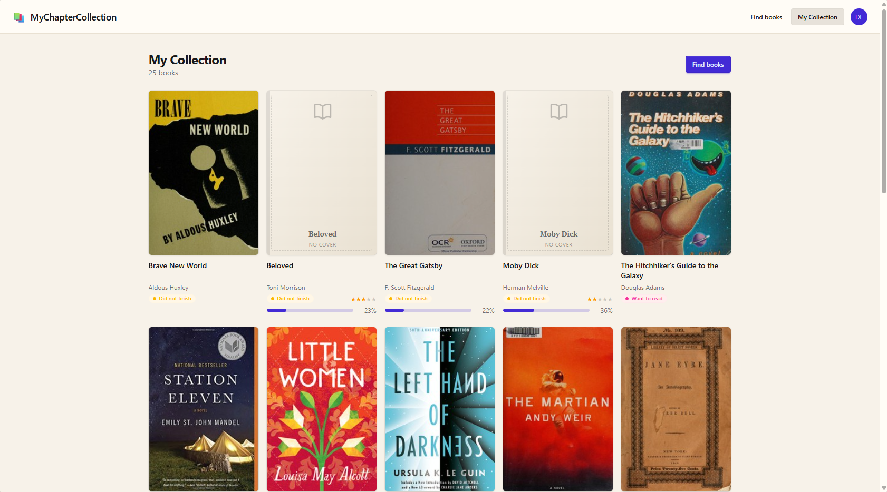
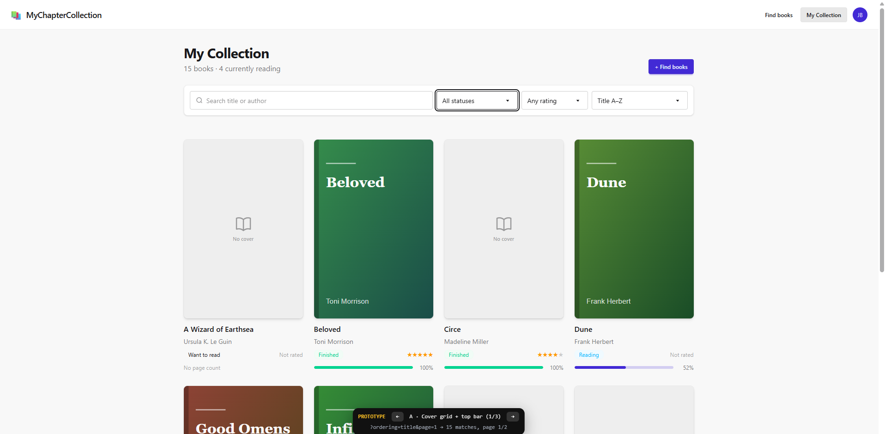
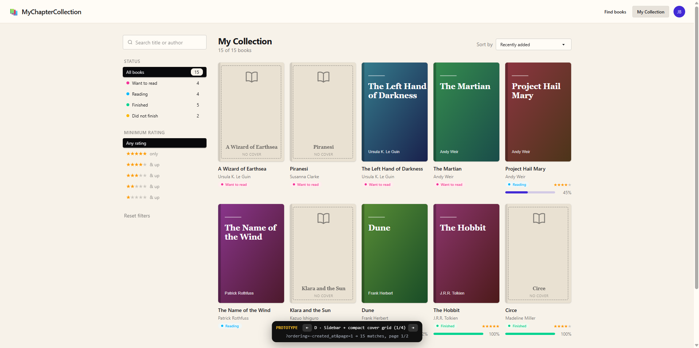

# Project #2: Building With APIs

## Question 1

I chose Open Library for my API provider. Before I chose Open Library, I looked at 10 different providers that Claude suggested. This part of my research is in docs/research/external-api-options.md, which allowed me to compare each API with each other. The main reason I chose Open Library is that it allows for saving records locally, so even if the API were to go down or under maintenance, saved books will still show up. A lot of the suggested APIs didn't allow this. Options like TMDB, Spoonacular, and Google Books all looked good but their ways of saving records had time and access restrictions that wouldn't work with all the needed requirements. TMDB only allows caching for 6 months, Spoonacular only lets you keep the ID, title and image while everything else can only be kept for an hour, and Google Books’ terms ban building databases. I chose Open Library since it didn't have any of these problems and it also doesn't need an API key or an account to use it. In addition to this, going to their developer page at openlibrary.org/developers/api tells developers to cache responses whenever they can, which allows me to save books in my database. And their licensing page at openlibrary.org/developers/licensing mentions that they do not claim any new rights over the data, which further made me lean more to this API choice. The alternative option I was thinking about using was TVmaze. This API doesn't require a key or account for use, so it was also another good choice that I could work with right away. I just decided not to use it due to its licensing conditions. On its page tvmaze.com/api under the licensing section, it mentioned that the API is licensed under CC BY-SA and that the data can be used as long as TVmaze is credited and that the ShareAlike provision is followed. I found Open Library to be more accessible with rules that woulnd't put me in a bind to follow, so I chose their API instead.

## Question 2

The prototype decision I chose was to see what the layout of the My Collection page would look like. I wanted the prototypes to show me book cover examples, a search bar, status and rating filters, 6 different ways to sort, and pagination. I decided to prototype this decision since the GitHub for this week's lesson had shown layout images of the example you had created. Seeing these images, I wanted to see what my project would look like and if I liked where it was heading. My prototype is in prototypes/collection-layouts.html. From this, I was able to click through 3 different layouts and compare them with one another. Layout A was a grid of book covers with the filters across the top, Layout B was a table with the filters in a sidebar, and Layout C used tabs, a list, and a side panel that showed the details of a book. Each layout had the same general idea but had things arranged differently from each other. I really liked the presentation of A with the books being in the middle with their covers, but preferred Layout B's filter sidebar placement. I ended up not choosing any of the layouts since I found problems with each. Layout A had the covers too big with only 4 covers per row, which would turn into a lot of scrolling for users. Layout B felt more like an admin dashboard and the covers were way too small, and Layout C just felt crammed and not all that neat. Instead I did a mix of B's sidebar with the cover grid of Layout A, and Claude then made a version D for me to review. After looking at version D, I still wanted a few more changes, so I asked Claude to change a couple of things. I changed it to 5 covers per row instead of 4, hid the progress bar on "Want to read" books since there isn't any progress yet, took out the "Not rated" text so the cards looked cleaner, and changed the background to a warm off-white. This decision shows up on the My Collection page at /books/, and the layout is in the template books/templates/books/_collection.html.

## Question 3

The update I traced is from my second script in scripts/my_books_api.py. The script changes my copy of Circe from page 0 to page 10 by sending a PATCH request to /api/books/13/. Before the script can change anything, it has to log in first. It uses the username and password saved in my .env file to get a token, and then it sends that token with every request after that. This is how Django knows who the user is, since it matches the token to my account. When the request comes in, config/urls.py sends anything starting with /api/ over to books/api_urls.py. In that file, a router connects /api/books/13/ to my view, which is SavedBookViewSet in books/api.py. This view only looks at the books saved by the logged-in user, so it can only find my books. Next, the data goes through SavedBookSerializer in books/serializers.py, which checks that the update is allowed. It doesn't let the user change the book info that came from Open Library, like the title and author, and it makes sure the page number isn't higher than the total pages in the book. Once everything checks out, the change gets saved to the database and the API sends back the updated book. Access is restricted in 2 differnt ways. If someone isn't logged in, they get a 401 error because of the IsAuthenticated setting in config/settings.py. And since the view only looks at the user's own books, if someone tries to open another user's book they just get a 404 error, so they wouldn't even know that book exists. I tested this with another account and got a 404. To make sure the change was saved, I checked it a few ways. The script showed the book before and after the update, and it showed current_page changing from 0 to 10. I also opened the app in the browser, and Circe showed page 10 with a 2% progress bar. In addition to this, I tried changing the title in the browsable API, and the title stayed the same while the date it was last updated changed, which showed me the update went through.

## Question 4

The page I chose is My Collection at /books/, which shows all the books I've saved. This page only pulls from my own database and never calls Open Library. The view for this page is in books/views.py on lines 38 to 69, and it starts by only grabbing the books that belong to the logged-in user. Most of the search, filtering, and sorting is in books/collection_query.py. The search is on lines 65 to 68, and it searches two fields, the title and the authors. It uses two Q objects, one for the title and one for the authors, and they are combined with OR. This means a book shows up if the word I search is in the title or in the author's name. It also uses icontains, which means the word can be anywhere in the text and capital letters don't matter. The filters are right after that on lines 69 to 72. The rating filter shows books with the rating I picked or higher, so if I pick 4 stars I get 4 and 5 star books, and books with no rating don't show up. The status filter only shows books that match the exact status I click on. Each filter is added on top of the last one, so the search, rating, and status all work together. The sorting is on lines 90 to 114, where each of the 6 sort options is matched to how the books should be ordered. Books with no rating or no year always get put at the end, and if two books are tied, they get sorted by title. For pagination, line 15 sets the page size to 20 books. The page links are made in books/templatetags/book_display.py on lines 36 to 41, and they only change the page number, so my search and filters stay the same when I go to the next page. In addition to this, the filter form in _collection.html doesn't have a page field, so whenever I change a filter, it takes me back to page 1. To check this in the browser, I searched "the." I thought it would only show books that start with "The," but I was wrong. It showed 16 of my books, and one of them was "J.R.R. Tolkien's The hobbit." That title doesn't start with "the," which proved that the search uses icontains and finds the word anywhere in the title. The status counts on the sidebar also added up to 16. Then I clicked Finished and it went down to 3 books, which is what I expected, since the status filter was added on top of my search. I also tried sorting by rating from high to low, and the 5 star books showed up first while the books with no rating got pushed to page 2. When I went to page 2, it still kept my sort, and when I clicked a different status, it took me back to page 1, which matched what the code was supposed to do.

## Question 5

While testing the features on my project, I found problems on my own that Claude didn't catch. The first issue I found was in Phase 1 when logging in. When I signed up or logged out, a message would show up either welcoming the user or telling them goodbye, but when I logged in, nothing would show up. The only time a message showed was when I first created my account. I asked Claude for a welcome message to be shown each time someone logs in. Now when you log in to the app, it says "Welcome back" along with the username at the top of the page. I found this to be a significant change since most apps I use have a confirmation message for when people log in. I find it to be a nice gesture but also a confirmation for the user that they have actually logged in and with the correct username. There have been times where I have 2 different accounts for an app and found out I logged in with the wrong account from the welcome message. Another problem I found was in Phase 4 with the back button. After saving a book from the search page, I pressed Back and the page still showed the save button like I never saved it. When I first saw it, I thought the save didn't actually go through, and I almost clicked save again before checking my collection and seeing the book was already there. This mattered because other users would probably do the same thing, so Claude made the page reload instead of showing the old copy. Also in Phase 4, books that were already in my collection could only be opened by clicking a small badge, not the cover or title. Whenever I'm on a website I usually click the picture or title first, so I asked for both to open my saved copy, and for unsaved books to open on Open Library in a new tab. Claude had left the covers on unsaved books unclickable on purpose, but I changed that since people expect to be able to click on a cover. In Phase 2, I noticed that long titles like "The Hitchhiker's Guide to the Galaxy" wrapped onto more lines than the other titles, which pushed its author and status lower than the rest of the books in that row. Seeing the row not line up made the page look unfinished to me, and it made it harder to quickly scan across the row and compare books. I asked for every title to take up the same two lines and show the full title when you hover over it, so now every row lines up evenly. The biggest change I requested was the layout of the My Collection page. Instead of picking one of Claude's three prototypes, I asked for a mix of Layout B's sidebar and Layout A's cover grid, then asked for a few more changes like 5 covers per row. I foudn this important since it's the page users would spend the most time on, so I didn't want to settle for the first options I was given.

Before image of the long title:

After image of the fix:

Before image of prototype a layout:

After image of the fixed layout:
